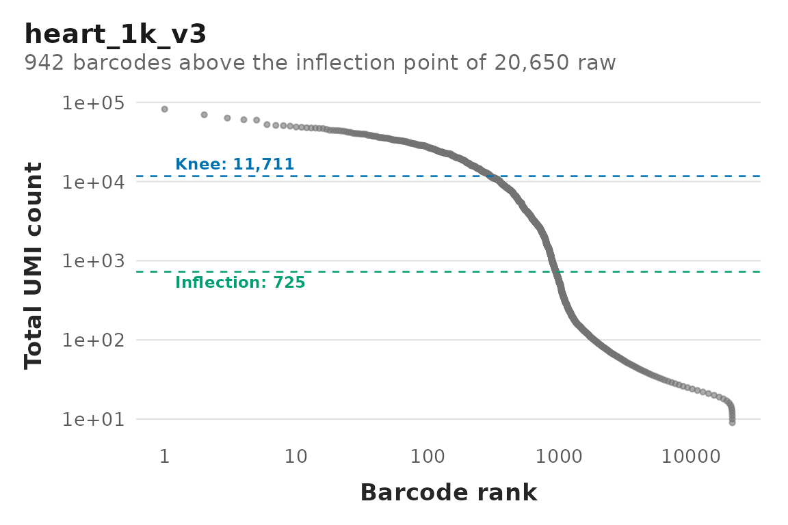
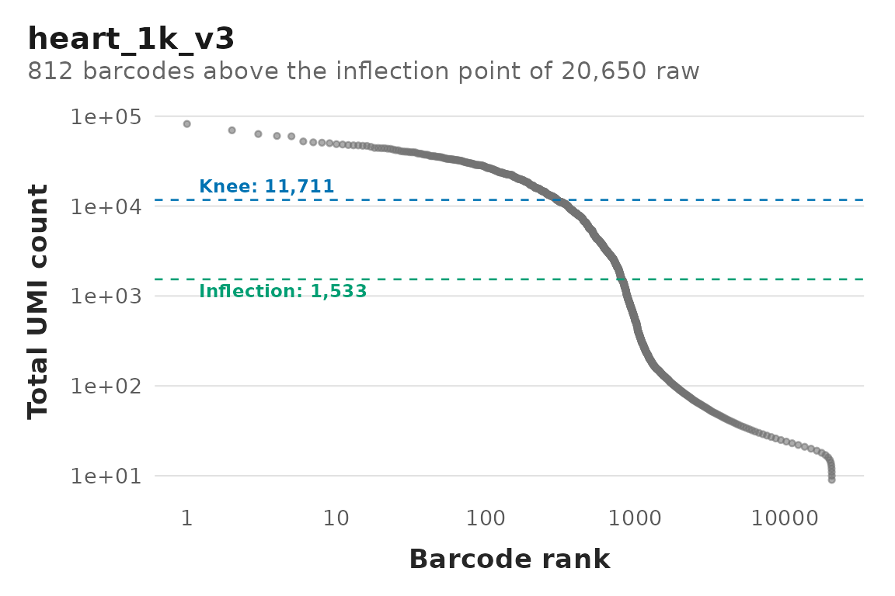
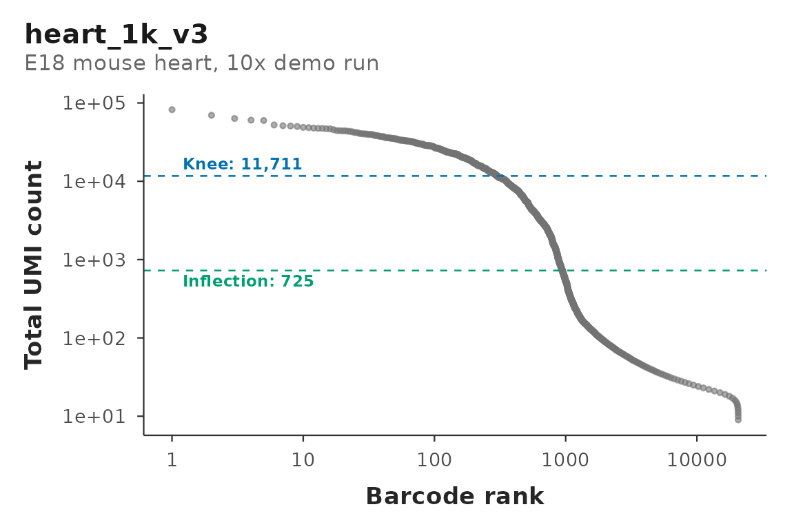

# Barcode rank plots for unpooled samples

``` r

library(rscprep)
```

A barcode rank plot is the first thing to look at when a sample comes
back with an unexpected cell count. It plots total UMI count against
barcode rank on log-log axes: a sharp cliff between a plateau of real
cells and a long tail of empty droplets means cell calling had an easy
decision to make, and a shallow gradual slope means it did not.

[`plotBarcodeRanks()`](https://mikemartinez99.github.io/rscprep/reference/plotBarcodeRanks.md)
draws that plot. This vignette covers the simplest case – one biological
sample per GEM well, nothing multiplexed, where each curve describes
exactly one sample and needs no caveats.

`DropletUtils` does the ranking and is a `Suggests`, not an `Imports`,
so install it before you start:

``` r

BiocManager::install(c("DropletUtils", "S4Vectors"))
```

## The example data

Every example in this vignette runs on data bundled with rscprep: a
cut-down copy of the 10x Genomics demo run [1k Heart Cells from an E18
Mouse (v3
chemistry)](https://www.10xgenomics.com/datasets/1-k-heart-cells-from-an-e-18-mouse-v-3-chemistry-3-standard-3-0-0).
It is one sample from one `cellranger count` run (Cell Ranger 3.0.0,
mm10 reference), with all 1,011 cells Cell Ranger called.

It comes in two forms, holding the same data:

- **`heart1k`** – a Seurat object, for examples that start after
  loading.
- **A Cell Ranger `outs/` directory** – for the functions that take a
  path. It holds `filtered_feature_bc_matrix.h5` (the called cells) and
  `raw_feature_bc_matrix.h5` (every barcode that had at least 25 UMIs in
  the original run, empty droplets included):

``` r

outs <- system.file("extdata", "heart_1k_v3", "outs", package = "rscprep")
```

To keep the package small, only 2,092 of the 31,053 genes are kept: the
2,000 detected in the most cells, plus every mitochondrial, ribosomal
protein and cell-cycle gene. Each cell therefore keeps about 70% of its
UMIs, and percentages such as `pctMito` read higher than they would on
the full gene set. That is fine for showing how the functions behave and
wrong for drawing conclusions about heart tissue.
[`?heart1k`](https://mikemartinez99.github.io/rscprep/reference/heart1k.md)
has the details, and `data-raw/heart_1k_v3.R` in the package source
rebuilds it from the 10x download.

The bundled raw matrix drops every barcode that had fewer than 25 UMIs
in the original run. After the gene subset those barcodes total as
little as 9, so the curves below stop near 10 on the y-axis; a full raw
matrix runs down to 1.

## One sample

``` r

ranks <- plotBarcodeRanks(
  path  = outs,
  multi = FALSE
)
#> ✔ "heart_1k_v3": 20650 raw barcodes, 2092 features.
#> ℹ "heart_1k_v3": knee at 11711 UMIs, inflection at 725 UMIs; 942 barcodes above the inflection (19708 below).
#> ✔ Ranked 1 run of 1.

ranks$heart_1k_v3$plot
```



`path` is the same `outs/` directory you would hand
[`seuratFrom10x()`](https://mikemartinez99.github.io/rscprep/reference/seuratFrom10x.md),
and the sample is named the same way (after the folder above `outs`).
What differs is which file gets read.

## Why this reads a different file

Cell calling is exactly the step that separates the raw matrix from the
filtered one. The filtered matrix has already had the empty droplets
removed, so the left-hand cliff (the thing the plot exists to show you)
is gone before you start.
[`plotBarcodeRanks()`](https://mikemartinez99.github.io/rscprep/reference/plotBarcodeRanks.md)
therefore reads the **raw** matrix:

|  | [`seuratFrom10x()`](https://mikemartinez99.github.io/rscprep/reference/seuratFrom10x.md) | [`plotBarcodeRanks()`](https://mikemartinez99.github.io/rscprep/reference/plotBarcodeRanks.md) |
|----|----|----|
| Reads | `outs/filtered_feature_bc_matrix.h5` | `outs/raw_feature_bc_matrix.h5` |
| Contains | barcodes called as cells | every barcode in the GEM well |
| Order | 10^3 to 10^4 columns | 10^5 to 10^6 columns (20,650 in the bundled copy) |

Nothing is filtered by this function. The knee and the inflection are
drawn so you can compare them against what Cell Ranger actually kept;
neither is a threshold applied to anything.

## “Unpooled” has two shapes

The distinction that matters for reading these curves is whether the GEM
well held one sample or several.

``` r

# A `cellranger count` run
plotBarcodeRanks(path = "/path/to/Sample_1/outs", multi = FALSE)

# A singleplex Flex or 5' run, processed with `cellranger multi`
plotBarcodeRanks(path = "/path/to/Sample_2/outs", multi = TRUE)
```

Both are unpooled, and both give you one curve for one sample. Set
`multi` to match the pipeline that wrote the directory, not to whether
anything was multiplexed: `cellranger multi` writes `per_sample_outs/`
even when it demultiplexed exactly one sample, and the raw matrix moves
with it:

| `multi` | Raw matrix location                         |
|---------|---------------------------------------------|
| `FALSE` | `outs/raw_feature_bc_matrix.h5`             |
| `TRUE`  | `outs/multi/count/raw_feature_bc_matrix.h5` |

If your `cellranger multi` output has been staged or flattened and the
raw matrix sits directly in `outs/`, that is checked as a fallback, so
both layouts resolve either way. `$h5` on the result records which file
was actually read.

The reason this is worth being careful about: for a genuinely pooled
run, `cellranger multi` writes **one** run-level raw matrix shared by
every demuxed sample, because cell calling happens once per GEM well and
only afterwards are barcodes assigned to samples. So a pool gives you
one curve describing the pool, not one curve per sample. When the well
held a single sample, that run-level matrix *is* that sample’s matrix
and the caveat disappears, which is why this vignette can treat both
rows above the same way.

## A batch of samples

Same manifest
[`seuratFrom10x()`](https://mikemartinez99.github.io/rscprep/reference/seuratFrom10x.md)
takes, so one table drives both halves of the workflow. The bundled data
is one sample, so this example uses placeholder paths and is not run:

``` r

manifest <- data.frame(
  Path = c(
    "/path/to/Sample_1/outs",
    "/path/to/Sample_2/outs",
    "/path/to/Sample_3/outs"
  ),
  multi = FALSE
)

ranks <- plotBarcodeRanks(manifest = manifest)

names(ranks)
#> [1] "Sample_1" "Sample_2" "Sample_3"
```

Runs are processed strictly one at a time – read, ranked, reduced to a
curve, released – so peak memory is set by your largest single sample
rather than by the length of the manifest. That matters here more than
it looks: a raw matrix has a column for every barcode in the well, and
holding a dozen of them at once is what makes this kind of loop fall
over.

## What comes back

One element per sample, each a list:

``` r

heart <- ranks$heart_1k_v3

head(heart$data)            # the plotted curve
#>              barcode rank total fitted
#> 1 ACTGTGACAGGGTTGA-1    1 82062     NA
#> 2 GGGACAAAGGGACTGT-1    2 69709     NA
#> 3 GCTTTCGAGGTCATCT-1    3 63381     NA
#> 4 GTTGCGGAGGTTGACG-1    4 60330     NA
#> 5 GATCACAAGGCTCACC-1    5 59737     NA
#> 6 CTCAAGAAGCGACTGA-1    6 52390     NA
heart$knee                  # optimistic cutoff, in UMIs
#> [1] 11710.79
heart$inflection            # permissive cutoff, in UMIs
#> [1] 724.8193
heart$n_barcodes            # barcodes in the raw matrix
#> [1] 20650
heart$n_above_inflection    # roughly, the cells you would expect
#> [1] 942
basename(heart$h5)          # the file this was computed from
#> [1] "raw_feature_bc_matrix.h5"
```

`heart$plot` is the ggplot2 object drawn above. Nothing was printed or
saved until it was asked for.

`data` is the curve, not the raw matrix: zero-count barcodes are dropped
(they have no place on a log axis, and in a raw matrix they are the
clear majority) and barcodes tying on total are collapsed to one row,
since they share a rank and plot at one point anyway. That turns
millions of rows into a few thousand – small enough to write to CSV,
which the full per-barcode table is not.

## The check this is actually for

`n_above_inflection` is a rough expected cell count derived
independently of Cell Ranger’s cell caller. Comparing it against what
the filtered matrix actually kept is the whole point of drawing these:

``` r

# min.cells / min.features off, so `called` is what Cell Ranger kept
seurat_list <- seuratFrom10x(path = outs, multi = FALSE,
                             min.cells = 0, min.features = 0)
#> ✔ "heart_1k_v3": 1011 cells, 2092 features.
#> ✔ Loaded 1 sample.

data.frame(
  expected = vapply(ranks, function(x) x$n_above_inflection, numeric(1)),
  called   = vapply(seurat_list, ncol, numeric(1))
)
#>             expected called
#> heart_1k_v3      942   1011
```

The two agree closely, which is what a clean run looks like: the curve
has a sharp cliff, and Cell Ranger’s cell caller and the inflection
point found nearly the same edge. A sample where they disagree badly is
the signal to go look at its curve. A shallow slope with no clear cliff
usually means ambient RNA, low viability, or a wetting failure, and the
called cell count from that sample should be treated with suspicion
regardless of which side of the discrepancy you believe.

## Writing figures out

``` r

outdir <- file.path(tempdir(), "barcode_ranks")
ranks  <- plotBarcodeRanks(path = outs, multi = FALSE, outdir = outdir)
#> ℹ Created /tmp/Rtmp2myAKd/barcode_ranks.
#> ✔ "heart_1k_v3": 20650 raw barcodes, 2092 features.
#> ℹ "heart_1k_v3": knee at 11711 UMIs, inflection at 725 UMIs; 942 barcodes above the inflection (19708 below).
#> ✔ "heart_1k_v3": wrote /tmp/Rtmp2myAKd/barcode_ranks/heart_1k_v3_barcode_ranks.csv and /tmp/Rtmp2myAKd/barcode_ranks/heart_1k_v3_barcode_ranks.png.
#> ✔ Ranked 1 run of 1.

list.files(outdir)
#> [1] "heart_1k_v3_barcode_ranks.csv" "heart_1k_v3_barcode_ranks.png"
```

Writes `<sample>_barcode_ranks.csv` and `<sample>_barcode_ranks.png` per
sample, creating the directory if needed, and still returns everything
in memory. Sample names come from directory names, so any character that
is not safe in a filename is replaced with `_` in the file stem only –
the list names are left alone. `width`, `height` and `dpi` are passed
through to
[`ggplot2::ggsave()`](https://ggplot2.tidyverse.org/reference/ggsave.html).

## Tuning the fit

`lower` is the total UMI count at or below which a barcode is assumed
empty. Only barcodes above it are searched for the knee and inflection;
it does **not** filter the curve, and barcodes below it are still
plotted.

``` r

plotBarcodeRanks(path = outs, multi = FALSE, lower = 500)$heart_1k_v3$plot
#> ✔ "heart_1k_v3": 20650 raw barcodes, 2092 features.
#> ℹ "heart_1k_v3": knee at 11711 UMIs, inflection at 1533 UMIs; 812 barcodes above the inflection (19838 below).
#> ✔ Ranked 1 run of 1.
```



Anything else goes to
[`DropletUtils::barcodeRanks()`](https://rdrr.io/pkg/DropletUtils/man/barcodeRanks.html):

``` r

plotBarcodeRanks(
  path         = outs,
  multi        = FALSE,
  lower        = 100,
  exclude.from = 50
)
#> ✔ "heart_1k_v3": 20650 raw barcodes, 2092 features.
#> ℹ "heart_1k_v3": knee at 11711 UMIs, inflection at 725 UMIs; 942 barcodes above the inflection (19708 below).
#> ✔ Ranked 1 run of 1.
```


`exclude.from` drops the highest-ranked barcodes from the search, which
helps when a handful of enormous barcodes drag the knee upward.

Which other arguments do anything depends on your DropletUtils version,
because `barcodeRanks()` changed how it finds the knee:

| DropletUtils | How the knee is found | Arguments that tune it | Fitted line on the plot |
|----|----|----|----|
| before 1.28 | smoothing spline, then its derivatives | `fit.bounds`, `df` | yes |
| 1.28 | spline; knee farthest from the plateau-to-inflection line | `fit.bounds`, `df` | yes |
| 1.30 and later | curve tracing, no spline | `window`, `gradient.threshold` | no – `data$fitted` is `NA` |

[`plotBarcodeRanks()`](https://mikemartinez99.github.io/rscprep/reference/plotBarcodeRanks.md)
adapts to whichever is installed. But the same data can give a different
knee, and sometimes a different inflection, under different versions, so
record `packageVersion("DropletUtils")` alongside any cutoff you report.

## Changing the figure

The plots are plain ggplots, so nothing is locked in:

``` r

library(ggplot2)

ranks$heart_1k_v3$plot +
  labs(subtitle = "E18 mouse heart, 10x demo run") +
  theme_prepro("clean")
```



And `data` is a plain data frame, so a single figure across every sample
is one `rbind` away. With several samples in `ranks` (one here, so this
is not run):

``` r

curves <- do.call(rbind, lapply(names(ranks), function(s) {
  cbind(Sample = s, ranks[[s]]$data)
}))

ggplot(curves, aes(rank, total, colour = Sample)) +
  geom_line() +
  scale_x_log10() +
  scale_y_log10() +
  scale_colour_prepro() +
  labs(x = "Barcode rank", y = "Total UMI count") +
  theme_prepro("airy")
```

Overlaying samples this way is usually more informative than reading the
per-sample figures side by side – a curve that sits below the others, or
turns over earlier, stands out immediately.

## When a sample fails

Two things can go wrong per sample: the raw matrix is missing, or
`barcodeRanks()` cannot fit a curve to it. Both follow the same rule as
[`seuratFrom10x()`](https://mikemartinez99.github.io/rscprep/reference/seuratFrom10x.md).

In manifest mode the sample is skipped with a warning and the rest of
the batch still runs, so the returned list can be shorter than the
manifest:

``` r

# the bundled sample, plus a run whose outs/ was never copied over
manifest <- data.frame(
  Path  = c(outs, file.path(tempdir(), "Sample_2", "outs")),
  multi = FALSE
)

ranks <- plotBarcodeRanks(manifest = manifest)
#> ✔ "heart_1k_v3": 20650 raw barcodes, 2092 features.
#> ℹ "heart_1k_v3": knee at 11711 UMIs, inflection at 725 UMIs; 942 barcodes above the inflection (19708 below).
#> Warning: Raw matrix for "Sample_2" not found at
#> /tmp/Rtmp2myAKd/Sample_2/outs/raw_feature_bc_matrix.h5
#> ✔ Ranked 1 run of 2.

setdiff(basename(dirname(manifest$Path)), names(ranks))
#> [1] "Sample_2"
```

In `path` mode the same condition is an error instead – there is no
other sample to fall back on, so failing quietly would leave you with an
empty list and no explanation.

If the raw matrix is genuinely absent, the usual cause is that only the
filtered outputs were copied off the sequencing core’s storage.
`raw_feature_bc_matrix.h5` is large and often gets left behind; there is
no way to reconstruct it from what you have, so it has to be fetched.

## Getting the matrices themselves

[`plotBarcodeRanks()`](https://mikemartinez99.github.io/rscprep/reference/plotBarcodeRanks.md)
never hands you a raw matrix – it reads each one, ranks it, and drops
it. If you want the matrices,
[`rawMatrixFrom10x()`](https://mikemartinez99.github.io/rscprep/reference/rawMatrixFrom10x.md)
takes the same arguments and returns them, with no such promise about
memory:

``` r

raw <- rawMatrixFrom10x(path = outs, multi = FALSE)
#> ✔ "heart_1k_v3": 20650 raw barcodes, 2092 features.
#> ✔ Loaded 1 raw matrix from 1 run.

dim(raw$heart_1k_v3)
#> [1]  2092 20650

range(Matrix::colSums(raw$heart_1k_v3))
#> [1]     9 82062
```

The original raw matrix had 6,794,880 barcodes. The bundled copy keeps
the 20,650 that had at least 25 UMIs before the gene subset.

It returns count matrices rather than Seurat objects on purpose.
Wrapping a raw matrix in a Seurat object means computing per-cell
metadata for hundreds of thousands of droplets that are about to be
discarded, and barcode ranking only ever needs the column sums.
